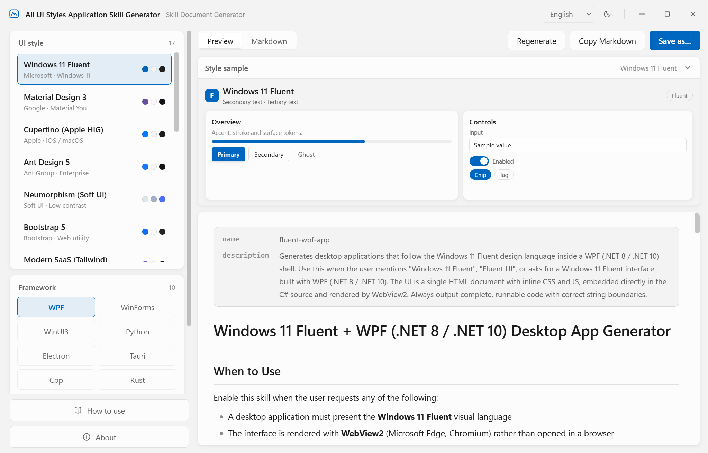

# ✨ All UI Styles Application Skill Generator
> 🎨 Full-Style Application Skill.md Generator

Generate uniquely styled Skill descriptions in one click, and say goodbye to generic AI boilerplate text!
Comes with **17 distinctive UI styles** and supports **10 major application frameworks**. Unleash your interface creativity and maximize the expressive power of your app framework.

🔗 Demo：https://lightlytech.github.io/All-UI-Styles-Application-Skill-Generator/

## 📌 About This Project
Tired of bland, AI-stereotyped prompt texts and Skill files?
This generator quickly produces polished `Skill.md` with strong visual personalities. With simple configuration, you can swap visual paradigms and craft custom interface specifications.

## 🚀 Key Features
- ✅ **Rich UI Style Library**: 17 differentiated UI styles, ranging from minimalism and skeuomorphism to retro and modern aesthetics
- ✅ **Multi-Framework Support**: Compatible with 10 mainstream application frameworks, switch carriers with one click
- ✅ **No Generic AI Flavor**: Carefully refined copy with high style recognition
- ✅ **Ready to Use**: Generated output can be copied and used in your project immediately
- ✅ **Extensible**: New styles and framework templates can be added easily

## 🧩 Built-in Assets
- 🎭 Number of UI styles: **17**
- 🛠️ Supported application frameworks: **10**

## 📖 Quick Start
1. Clone this repository locally
2. Launch the generator
3. Pick your desired UI style and target framework
4. Generate `Skill.md` with one click
5. Copy the result and import it into your project

